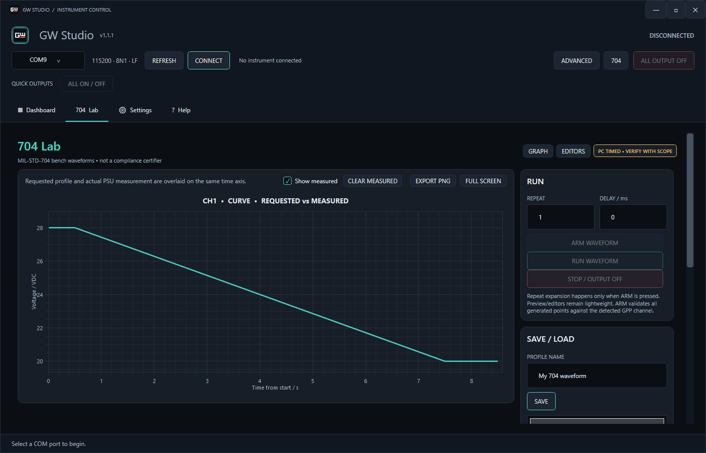
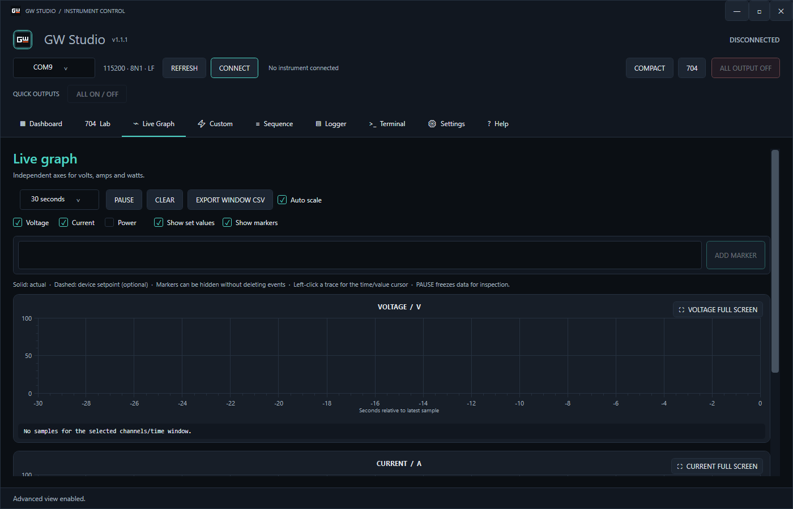

<div align="center">


# GW Studio

**Control, monitor, log and automate your GW Instek GPP bench power supply from Windows.**

Supports **GPP-3060** and **GPP-4323** · USB CDC (virtual COM port) · Auto model detection

**English** · [Türkçe](README.tr.md)




</div>

---

## ✨ What can it do?

| | |
| --- | --- |
| 🔌 **Auto detection** | Connect and the right channels and limits appear, based on the instrument's `*IDN?` reply |
| 📟 **Live dashboard** | Large V / A / W readouts, setpoints, CV / CC / CR / TRIP badges, quick presets |
| 📈 **Live graphs** | Pause, zoom, cursor, event markers, full screen, export to CSV / PNG |
| 📝 **Logging** | Continuous CSV logging and one-click PDF session reports |
| 🧪 **Test automation** | Custom V/I profiles, native sequences and the **704 Lab** waveform builder |
| 🖥️ **Terminal** | Send raw SCPI commands when you need to |
| 🛡️ **Safety first** | Connecting never switches an output; one big **ALL OUTPUT OFF** button |
| 🔄 **Optional updates** | Asks before it downloads or installs anything |

---

## 🚀 Quick start

### 1. Download

Get the latest build from the [**Releases**](https://github.com/d0ukan/GW-Studio/releases) page:

| Package | Use it when |
| --- | --- |
| **Setup** (`GW-Studio-Setup-vX.Y.Z.exe`) | You want a normal install with Start Menu entry and updates |
| **Portable** (`GW-Studio-Portable-vX.Y.Z.zip`) | You want to unzip and run it from any folder or USB stick |

> No separate .NET installation is needed, both packages include everything the app requires.
> You only need the **GW Instek USB CDC driver** so Windows sees the instrument as a COM port.

### 2. Connect

Plug in the power supply over USB, pick its COM port and press **CONNECT**. GW Studio identifies the model and builds the matching channel cards. Your outputs stay exactly as they were.

### 3. Set and switch on

Enter voltage and current limit, press **APPLY SETTINGS**, then switch the channel output **ON**. Applying values never turns an output on by itself.

---

## 🖼️ A quick tour

### Dashboard
Everything for day-to-day bench work: live readings, setpoints, locks and presets. Switch between **COMPACT** and **ADVANCED** in the header to show only what you need.

### Live Graph
Watch voltage, current and power in real time. Output, setpoint and protection events are marked automatically.



### 704 Lab
Build voltage waveforms (linear, exponential, logarithmic, inverse-time, reference equation), edit them with segments or by dragging points, pick a ready template from the test library, and run them with loop/repeat.


> PC-timed bench aid only. It is **not** a MIL-STD-704 compliance tool.

### Logger and PDF reports
Log every reading to CSV and generate a PDF report of your session when you are done.

---

## 🛡️ Safety in one minute

- **Connect never changes an output.**
- **APPLY changes setpoints only.** Output ON is always an explicit action.
- **ALL ON** only works from a verified all-OFF state; otherwise the first press turns everything OFF.
- Out-of-range values, wrong-model profiles and unsupported channels are rejected **before** anything is sent to the instrument.
- Software current auto-off depends on polling speed. It does **not** replace the instrument's hardware OVP / OCP.

---

## 📦 Supported instruments

| Model | Channel | Programmable range |
| --- | --- | --- |
| GPP-3060 | CH1 / CH2 | 0–32 V, 0–6 A |
| GPP-3060 | CH3 | 1.8 / 2.5 / 3.3 / 5 V, fixed 5 A (output on/off only) |
| GPP-4323 | CH1 / CH2 | 0–32 V, 0–3 A |
| GPP-4323 | CH3 | 0–5 V, 0–1 A |
| GPP-4323 | CH4 | 0–15 V, 0–1 A |

Serial link: 115200 baud, 8N1, LF termination.

---

<details>
<summary><b>🔧 Build from source</b></summary>

Requirements: Windows 10/11 and the [.NET 8 SDK](https://dotnet.microsoft.com/download/dotnet/8.0).

```powershell
dotnet restore GW-Studio.sln
dotnet build GW-Studio.sln -c Release
dotnet run --project GW-Studio.csproj

# console tests (no hardware needed)
dotnet run --project Tests/GW-Studio.Tests.csproj -c Release
```

Release packages (self-contained, so end users need no .NET install):

```powershell
dotnet publish GW-Studio.csproj -c Release -r win-x64 --self-contained true -o publish
```

`Tests/serial_pty_test.py` is a Linux-only integration fixture that drives the real `SerialDeviceService` through a pseudo-terminal: `python3 Tests/serial_pty_test.py /path/to/dotnet`.

</details>

<details>
<summary><b>📁 Project layout</b></summary>

```text
GW-Studio.sln
GW-Studio.csproj   WPF app (net8.0-windows)
Controls/          ChannelCard, GraphPanel, LiveChartControl
Views/             Dashboard, 704 Lab, Custom, Sequence, Logger, Terminal, Settings, Help
ViewModels/        MVVM view models
Models/            Device models, profiles, update info
Services/          Serial/GPP device, polling, CSV/PDF/plot export, settings, updates
Helpers/           Commands, number parsing, version info
Themes/            Dark/cyan theme
Tests/             Console test project + serial PTY fixture
docs/              SCPI commands, hardware checklist, update flow, manual notes
```

Dependencies: `System.IO.Ports` 8.0.0, `OxyPlot.Wpf` 2.2.0.

</details>

<details>
<summary><b>💾 Where is my data?</b></summary>

| Data | Location |
| --- | --- |
| Settings | `%APPDATA%\Dou-GW-Studio\settings.json` |
| Custom profiles | `%LOCALAPPDATA%\Dou-GW-Studio\Profiles` |
| Logs and PDF reports | `Logs\yyyy-MM-dd\` next to the executable, otherwise `%LOCALAPPDATA%\GW Studio\Logs\yyyy-MM-dd\` |
| Application / update log | `GW_Studio_App.log` in the daily Logs folder |

</details>

<details>
<summary><b>🔄 How online updates work</b></summary>

GW Studio quietly checks the latest [GitHub Release](https://github.com/d0ukan/GW-Studio/releases/latest) after startup. If a newer version exists it asks **Update Now / Later**. Nothing is downloaded or installed without your approval, and network problems never block startup or device control. You can also check manually in the **Help** tab.

The **Setup** edition downloads and starts the new installer. The **Portable** edition (it contains a `portable.txt` marker) never updates itself: it only opens the download page, and you replace the folder with the new ZIP. More in [docs/ONLINE-UPDATE.md](docs/ONLINE-UPDATE.md).

</details>

---

## 📚 More documentation

[SCPI commands](docs/COMMANDS.md) · [Hardware checklist](docs/HARDWARE-CHECK.md) · [Manual notes](docs/GPP-SERIES-MANUAL-NOTES.md) · [Online update](docs/ONLINE-UPDATE.md) · [Changelog](CHANGELOG.md)

<div align="center">

Made by Dou.

</div>
