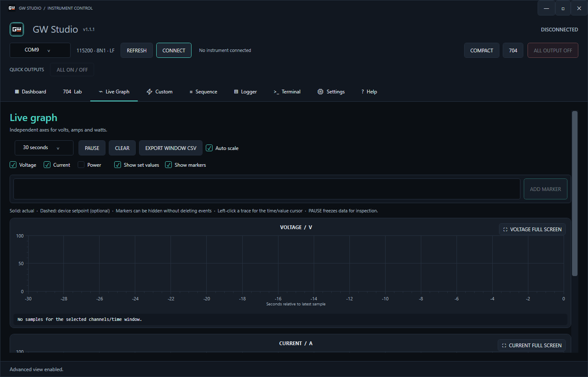
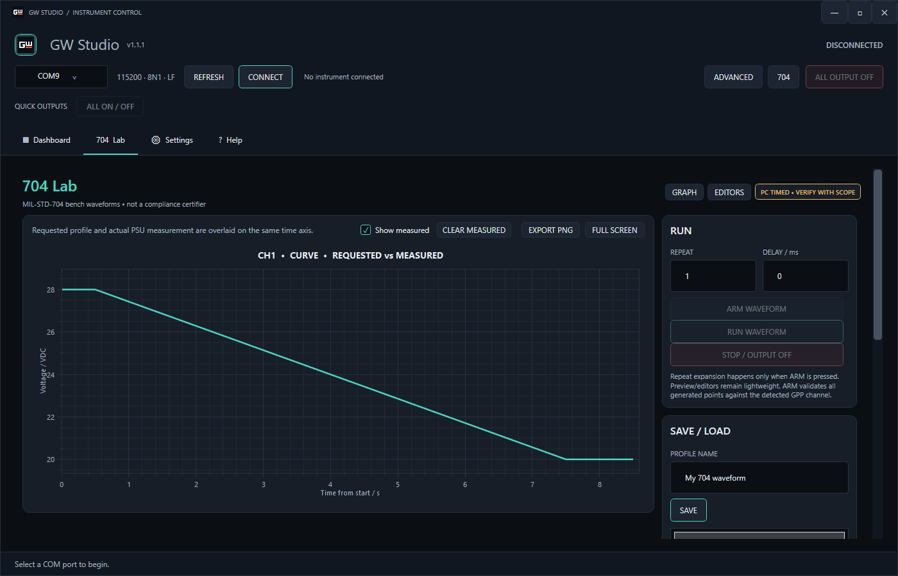

<div align="center">


# GW Studio

**GW Instek GPP laboratuvar güç kaynağınızı Windows'tan kontrol edin, izleyin, kaydedin ve test otomasyonu yapın.**

**GPP-3060** ve **GPP-4323** · USB CDC (sanal COM port) · Otomatik model algılama

[English](README.md) · **Türkçe**


</div>

---

## ✨ Neler yapabilir?

| | |
| --- | --- |
| 🔌 **Otomatik algılama** | Bağlanın; cihazın `*IDN?` yanıtına göre doğru kanallar ve limitler otomatik gelir |
| 📟 **Canlı panel** | Büyük V / A / W göstergeleri, set değerleri, CV / CC / CR / TRIP rozetleri, hızlı presetler |
| 📈 **Canlı grafik** | Duraklat, yakınlaştır, imleç, olay işaretleri, tam ekran, CSV / PNG dışa aktarma |
| 📝 **Kayıt** | Sürekli CSV kaydı ve tek tıkla PDF oturum raporu |
| 🧪 **Test otomasyonu** | Özel V/I profilleri, yerel sequence ve **704 Lab** dalga formu oluşturucu |
| 🖥️ **Terminal** | İhtiyaç olduğunda ham SCPI komutu gönderin |
| 🛡️ **Önce güvenlik** | Bağlanmak hiçbir çıkışı açmaz; büyük bir **ALL OUTPUT OFF** düğmesi |
| 🔄 **İsteğe bağlı güncelleme** | Bir şey indirmeden veya kurmadan önce sorar |

---

## 🚀 Hızlı başlangıç

### 1. İndirin

En son sürümü [**Releases**](https://github.com/d0ukan/GW-Studio/releases) sayfasından alın:

| Paket | Ne zaman? |
| --- | --- |
| **Setup** (`GW-Studio-Setup-vX.Y.Z.exe`) | Normal kurulum, Başlat menüsü kısayolu ve uygulama içi güncelleme istiyorsanız |
| **Portable** (`GW-Studio-Portable-vX.Y.Z.zip`) | ZIP'i açıp herhangi bir klasörden veya USB bellekten çalıştırmak istiyorsanız |

> Ayrıca .NET kurmanız gerekmez; iki paket de uygulamanın ihtiyaç duyduğu her şeyi içerir.
> Sadece Windows'un cihazı COM port olarak görmesi için **GW Instek USB CDC sürücüsü** gerekir.

### 2. Bağlanın

Güç kaynağını USB ile takın, COM portunu seçin ve **CONNECT**'e basın. GW Studio modeli tanır ve ona uygun kanal kartlarını oluşturur. Çıkışlarınız olduğu gibi kalır.


### 3. Ayarlayın ve açın

Gerilim ve akım limitini girin, **APPLY SETTINGS**'e basın, sonra kanal çıkışını **ON** yapın. Değerleri uygulamak çıkışı kendiliğinden açmaz.

---

## 🖼️ Kısa tur

### Dashboard
Günlük bench çalışması için her şey: canlı ölçümler, set değerleri, kilitler ve presetler. Başlıktaki **COMPACT / ADVANCED** düğmesiyle sadece ihtiyacınız olanı gösterebilirsiniz.


### Live Graph
Gerilim, akım ve gücü gerçek zamanlı izleyin. Çıkış, set ve koruma olayları otomatik işaretlenir.



### 704 Lab
Gerilim dalga formları oluşturun (lineer, üstel, logaritmik, ters-zaman, referans denklem), segment ile veya noktaları sürükleyerek düzenleyin, test kütüphanesinden hazır şablon seçin ve döngü/tekrar ile çalıştırın.



> Sadece PC zamanlamalı bir bench yardımcısıdır. MIL-STD-704 uygunluk aracı **değildir**.

### Logger ve PDF raporları
Tüm ölçümleri CSV'ye kaydedin, işiniz bitince oturumun PDF raporunu oluşturun.


---

## 🛡️ Bir dakikada güvenlik

- **Bağlanmak hiçbir çıkışı değiştirmez.**
- **APPLY sadece set değerlerini değiştirir.** Çıkışı açmak her zaman ayrı ve bilinçli bir işlemdir.
- **ALL ON** sadece doğrulanmış "hepsi kapalı" durumundan çalışır; aksi halde ilk basış her şeyi kapatır.
- Aralık dışı değerler, yanlış model profilleri ve desteklenmeyen kanallar cihaza **hiçbir şey gönderilmeden önce** reddedilir.
- Yazılımsal akım auto-off, polling hızına bağlıdır. Cihazın donanımsal OVP / OCP korumasının yerini **tutmaz**.

---

## 📦 Desteklenen cihazlar

| Model | Kanal | Programlanabilir aralık |
| --- | --- | --- |
| GPP-3060 | CH1 / CH2 | 0–32 V, 0–6 A |
| GPP-3060 | CH3 | 1.8 / 2.5 / 3.3 / 5 V, sabit 5 A (sadece çıkış aç/kapat) |
| GPP-4323 | CH1 / CH2 | 0–32 V, 0–3 A |
| GPP-4323 | CH3 | 0–5 V, 0–1 A |
| GPP-4323 | CH4 | 0–15 V, 0–1 A |

Seri bağlantı: 115200 baud, 8N1, LF sonlandırma.

---

<details>
<summary><b>🔧 Kaynaktan derleme</b></summary>

Gereksinim: Windows 10/11 ve [.NET 8 SDK](https://dotnet.microsoft.com/download/dotnet/8.0).

```powershell
dotnet restore GW-Studio.sln
dotnet build GW-Studio.sln -c Release
dotnet run --project GW-Studio.csproj

# konsol testleri (cihaz gerekmez)
dotnet run --project Tests/GW-Studio.Tests.csproj -c Release
```

Release paketleri self-contained üretilir, yani son kullanıcının .NET kurması gerekmez:

```powershell
dotnet publish GW-Studio.csproj -c Release -r win-x64 --self-contained true -o publish
```

Setup için [Inno Setup 6](https://jrsoftware.org/isinfo.php) ve `installer/GW-Studio.iss` kullanılır. Release'ler `v*` etiketi atıldığında GitHub Actions ile otomatik üretilir (`.github/workflows/release.yml`).

</details>

<details>
<summary><b>📁 Proje yapısı</b></summary>

```text
GW-Studio.sln
GW-Studio.csproj   WPF uygulaması (net8.0-windows)
Controls/          ChannelCard, GraphPanel, LiveChartControl
Views/             Dashboard, 704 Lab, Custom, Sequence, Logger, Terminal, Settings, Help
ViewModels/        MVVM view model'leri
Models/            Cihaz modelleri, profiller, güncelleme bilgisi
Services/          Seri/GPP cihaz, polling, CSV/PDF/grafik dışa aktarma, ayarlar, güncelleme
Helpers/           Komutlar, sayı ayrıştırma, sürüm bilgisi
Themes/            Koyu/camgöbeği tema
Tests/             Konsol test projesi + seri PTY fixture
installer/         Inno Setup scripti
docs/              SCPI komutları, donanım kontrol listesi, güncelleme akışı, kılavuz notları
```

</details>

<details>
<summary><b>💾 Verilerim nerede?</b></summary>

| Veri | Konum |
| --- | --- |
| Ayarlar | `%APPDATA%\Dou-GW-Studio\settings.json` |
| Özel profiller | `%LOCALAPPDATA%\Dou-GW-Studio\Profiles` |
| Log ve PDF raporları | Exe'nin yanında `Logs\yyyy-MM-dd\`, olmazsa `%LOCALAPPDATA%\GW Studio\Logs\yyyy-MM-dd\` |
| Uygulama / güncelleme logu | Günlük Logs klasöründe `GW_Studio_App.log` |

</details>

<details>
<summary><b>🔄 Online güncelleme nasıl çalışır?</b></summary>

GW Studio açıldıktan sonra sessizce en son [GitHub Release](https://github.com/d0ukan/GW-Studio/releases/latest) sürümünü kontrol eder. Daha yeni sürüm varsa **Update Now / Later** diye sorar. Onayınız olmadan hiçbir şey indirilmez veya kurulmaz; ağ sorunları açılışı ve cihaz kontrolünü asla engellemez. **Help** sekmesinden elle de kontrol edebilirsiniz.

**Setup** sürümü güncellemeyi indirip kurulumu başlatır. **Portable** sürüm kendini güncellemez; yeni sürüm olduğunda sadece indirme sayfasını açar, yeni ZIP'i indirip klasörün üzerine kopyalarsınız. Ayrıntı: [docs/ONLINE-UPDATE.md](docs/ONLINE-UPDATE.md).

</details>

---

## 📚 Diğer dokümanlar

[SCPI komutları](docs/COMMANDS.md) · [Donanım kontrol listesi](docs/HARDWARE-CHECK.md) · [Kılavuz notları](docs/GPP-SERIES-MANUAL-NOTES.md) · [Online güncelleme](docs/ONLINE-UPDATE.md) · [Changelog](CHANGELOG.md)

<div align="center">

Made by Dou.

</div>
