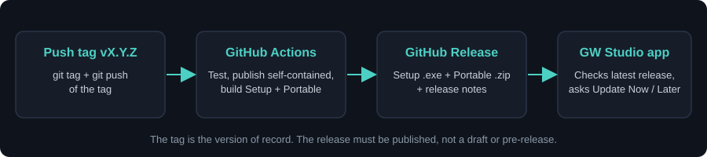

# Releasing GW Studio



Releases are built by GitHub Actions ([`.github/workflows/release.yml`](../.github/workflows/release.yml)) when a `vX.Y.Z` tag is pushed. The in-app updater reads the latest GitHub Release, so the **tag is the version of record**.

## Checklist

1. **Bump the version** (same number everywhere):
   - `GW-Studio.csproj`: `Version`, `AssemblyVersion` (`X.Y.Z.0`), `FileVersion` (`X.Y.Z.0`), `InformationalVersion`
   - `installer/GW-Studio.iss`: the default `MyAppVersion`
   - `Tests/GW-Studio.Tests.csproj` version (optional, keeps tests aligned)
2. **Write the release notes** in `CHANGELOG.md`. Rename the `# Unreleased` heading to `# vX.Y.Z — YYYY-MM-DD`. The text under that heading becomes the GitHub Release body and the notes shown in the update prompt.
3. **Test locally:**
   ```powershell
   dotnet build GW-Studio.sln -c Release
   dotnet run --project Tests/GW-Studio.Tests.csproj -c Release
   ```
4. **Commit and push** to `main`.
5. **Tag and push the tag:**
   ```powershell
   git tag vX.Y.Z
   git push origin vX.Y.Z
   ```
6. Watch the **Actions** tab. When it is green, the **Releases** page has:
   - `GW-Studio-Setup-vX.Y.Z.exe` (installer, used by the in-app updater)
   - `GW-Studio-Portable-vX.Y.Z.zip`
7. Open the release and check that it is **published** (not draft, not pre-release) and the notes look right. Edit them on GitHub if needed.
8. Install the previous version, launch it and confirm the update prompt appears.

## Release notes: what to write

Short, user-facing, grouped by what changed. Example:

```markdown
# v1.2.0 — 2026-11-10

### New
- Update check now uses GitHub Releases; Portable edition added.
- 704 Lab: <short description of the new thing>.

### Improved
- <what is faster, clearer or safer>.

### Fixed
- <what was broken and is now correct>.

### Safety / device behavior
- No change to output switching rules.   <- always state this explicitly, one way or the other
```

Tips:
- Write for bench users, not developers: say what they will notice, not which class changed.
- **Always mention anything touching device control, limits, ALL ON/OFF, auto-off or profile compatibility.** If nothing changed there, say so.
- Mention breaking changes (for example profiles that must be rebuilt) at the top.
- Keep it to a handful of bullets. The update prompt shows the text in a small box.

## Fixing a bad release

- Edit the release notes on GitHub at any time; they are not baked into the app.
- Pull a broken release by marking it **draft** or deleting it: the updater then falls back to the previous published release.
- To rebuild the same version, delete the release and the tag (`git push origin :refs/tags/vX.Y.Z`, `git tag -d vX.Y.Z`), then tag again. Prefer shipping a new patch version instead.

## First release

The first GitHub release must have a version **higher** than any installed copy (for example `v1.2.0` when `1.1.1` is out), otherwise the updater reports "latest version". Copies older than this change still check the retired portal and need one manual install.
